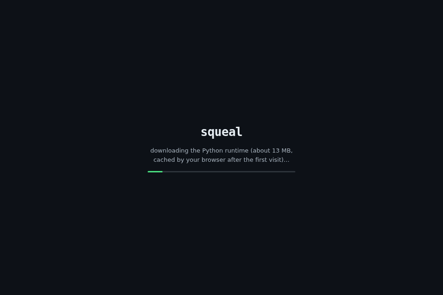

# squeal

The SQL engine for CSV files that you can read in an afternoon.
Written from scratch in pure Python with zero dependencies - no numpy,
no pandas, nothing but the standard library: lexer, recursive descent
parser, expression evaluator, row executor, EXPLAIN, CLI/REPL, each
stage one small module.

It is not fast, and it does not pretend to be: on the measured set it
runs 7x to 121x slower than SQLite ([honest numbers](docs/benchmarks.md)).
The point is the other direction. The whole engine fits in your head,
the dialect is one documented page with its differences called out,
and correctness is a published, checkable claim: 291 tests plus an
80-record [sqllogictest corpus](tests/sqllogictest) verified against
SQLite, with every deliberate difference pinned and explained.



**Try it in your browser: [squeal playground](https://therealalexxx.github.io/squeal/playground/)**
- the whole engine compiled to WebAssembly, querying real CSVs, no
install. Your files never leave the device.

## Install

```
pip install git+https://github.com/TheRealAlexxx/squeal.git
```

Or run it from a checkout with no install at all:

```
PYTHONPATH=. python3 -m squeal.cli "select 1 + 1"
```

## Try it

There is a sample dataset in `examples/orders.csv`: twenty orders with
a couple of missing prices.

```
$ squeal "select region, count(*) as orders, sum(quantity) as items,
          round(sum(quantity * unit_price), 2) as revenue
          from 'examples/orders.csv'
          group by region having count(*) >= 4
          order by revenue desc"
+----------+--------+-------+---------+
| region   | orders | items | revenue |
+----------+--------+-------+---------+
| eu-north | 6      | 13    | 4339.95 |
| us-east  | 5      | 14    | 3709.43 |
| us-west  | 5      | 8     | 2230.97 |
| ap-south | 4      | 9     | 1797.94 |
+----------+--------+-------+---------+
(4 rows)
```

Note what did not happen: the two orders with a missing `unit_price`
did not crash the multiplication and did not count as zero. They
became NULL, and NULL sums skip them, the way SQL says they should.

## Joins too

```
$ squeal "select p.category, count(*) as orders,
          round(sum(o.quantity * o.unit_price), 2) as revenue
          from 'examples/orders.csv' o
          join 'examples/products.csv' p on o.product = p.product
          group by p.category order by revenue desc"
+-------------+--------+---------+
| p.category  | orders | revenue |
+-------------+--------+---------+
| computers   | 5      | 9093    |
| displays    | 4      | 1745    |
| accessories | 11     | 1240.29 |
+-------------+--------+---------+
(3 rows)
```

Equijoins run as hash joins. `EXPLAIN ANALYZE` shows the strategy and
the measured row counts:

```
Scan  examples/orders.csv as o   -- 20 rows
-> Hash Join  examples/products.csv as p on (o.product = p.product)   -- 20 joined rows
  -> Aggregate  group by: p.category   -- 3 groups
    -> Project  p.category, count(*)   -- 3 rows
elapsed: 0.2 ms
```

## What it speaks

- `SELECT` with expressions, `AS` aliases, `*`, and `DISTINCT`
- `FROM 'file.csv'` (or a bare name, resolved to `name.csv`), with
  `INNER`/`LEFT`/`CROSS JOIN ... ON`, table aliases, and qualified
  column names (`orders.id`), ambiguity detected and reported
- `WHERE` with full precedence: `or`, `and`, `not`, comparisons,
  `IS [NOT] NULL`, `[NOT] LIKE`, `[NOT] IN (...)`, `[NOT] BETWEEN`
- Subqueries: `IN (SELECT ...)`, scalar subqueries, `EXISTS (SELECT ...)`,
  correlated or not, with result caching and probe sets to keep the
  common cases cheap
- `CREATE VIEW` / `DROP VIEW` for named queries in a session or script
- `GROUP BY` and `HAVING`, with `count`, `sum`, `avg`, `min`, `max`,
  `group_concat`, all accepting `DISTINCT`
- Window functions: `row_number()`, `rank()`, `dense_rank()`, and
  windowed aggregates with `OVER (PARTITION BY ... ORDER BY ...)`
- `ORDER BY` (multiple keys, `ASC`/`DESC`, select aliases and positions
  allowed, NULLs always last)
- `LIMIT` and `OFFSET`
- Compound selects: `UNION`, `UNION ALL`, `INTERSECT`, `EXCEPT`,
  equal precedence evaluated left to right, like SQLite
- `WITH` clauses (named statement-scoped subqueries) and
  `WITH RECURSIVE`: working-table iteration, cycle-safe under
  `UNION`, a 100,000-row guard, and early termination under an
  unordered `LIMIT`
- Arithmetic `+ - * / %`, string concat `||`, `CASE WHEN ... END`
- 21 scalar functions, from `upper` to `sqrt`; see
  [docs/sql-reference.md](docs/sql-reference.md)
- `EXPLAIN <query>` prints the pipeline; `EXPLAIN ANALYZE <query>`
  runs it and annotates every stage with measured row counts
- Three output formats: `--format table|csv|json`
- An experimental columnar engine for simple scans:
  `--engine columnar` evaluates WHERE over whole column lists instead
  of row by row. It covers a narrow subset (single-table CSV scans,
  simple predicates, basic aggregates, one GROUP BY key). Anything
  else - joins, views, ORDER BY, even `select 1 + 1` - runs on the row
  engine with a note on stderr saying why, and EXPLAIN names the
  engine a query would use. Measured in
  [docs/benchmarks.md](docs/benchmarks.md#columnar-experiment)
- A REPL when you run `squeal` with no query, and script mode when you
  pipe a file of statements into it
- Errors point at the exact character, and unknown columns suggest the
  name you probably meant:

```
$ squeal "select from"
error: expected a value but found 'from'
  select from
         ^
$ squeal "select regoin from 'examples/orders.csv'"
error: no such column: regoin (did you mean region?)
```

## The dialect, honestly

- **NULLs are real.** Comparison or arithmetic with NULL yields NULL.
  `WHERE` keeps a row only when the predicate is TRUE, so NULL and
  FALSE both reject. `AND`/`OR`/`NOT` follow the SQL truth tables.
- **CSV types are inferred per column** from the whole file: all
  integers means int, all numeric means float, anything else means
  text. Empty cells are NULL. One stray word in a number column
  demotes the whole column to text instead of crashing.
- **Mixed-type comparisons never raise.** Numbers always sort before
  text, so `5 < 'apple'` is true and consistent.
- **`LIKE` is case sensitive.** `%` matches any run, `_` one character.
- **No FROM** computes a single row: `select 6 * 7 as answer`.
- **Strings are 1-based** in `substr`, like the standard says.
- `FROM` names CSV files, views and CTEs. No derived tables
  (a parenthesized SELECT) yet.

## How it works inside

```
SQL text
  -> squeal/lexer.py     tokens with line/column positions
  -> squeal/parser.py    recursive descent, one Select tree out
  -> squeal/astnodes.py  dumb value objects, zero behavior
  -> squeal/executor.py  scan, filter, group, having, project,
                         distinct, sort, limit
  -> squeal/values.py    NULL logic, comparisons, functions
  -> squeal/render.py    table, csv or json output
```

The executor is deliberately row-based. There is no query optimizer;
EXPLAIN shows the fixed pipeline with the stages your query activates.
That keeps the whole execution model in your head, which is the point.

## Develop and test

```
PYTHONPATH=. python3 -m unittest discover -s tests
```

The suite covers the lexer, parser, value semantics, executor, joins,
subqueries, window functions, the playground bridge, the columnar
engine's row-for-row parity with the row engine, and the CLI end to
end: 291 tests. CI
runs it on Python 3.9 through 3.12.

The published correctness claim is a sqllogictest subset: 80 records
in [tests/sqllogictest](tests/sqllogictest), where the feature files
were verified against SQLite at generation time and
[pinned.test](tests/sqllogictest/pinned.test) documents each deliberate
dialect difference. The count in this paragraph is asserted by the
test suite, so it cannot drift from the corpus.

## Performance

Honest numbers, generated by a seeded harness, live in
[docs/benchmarks.md](docs/benchmarks.md). Short version: 10k rows
filter in about 30 ms, and a naive `IN (SELECT ...)` used to take
13 s on that dataset until subquery results got cached (now 0.35 s).

## Roadmap

Joins, correlated subqueries, window functions, views and the columnar
experiment all landed; see the [changelog](CHANGELOG.md). What is
deliberately missing today, roughly in order of usefulness:
`lag()`/`lead()` and frame-clause windows, derived tables in `FROM`,
`CAST`, and select aliases in `HAVING`. Each of those is currently a
pinned, documented error in
[tests/sqllogictest/pinned.test](tests/sqllogictest/pinned.test).

## License

MIT. Do what you like; credit is nice.
